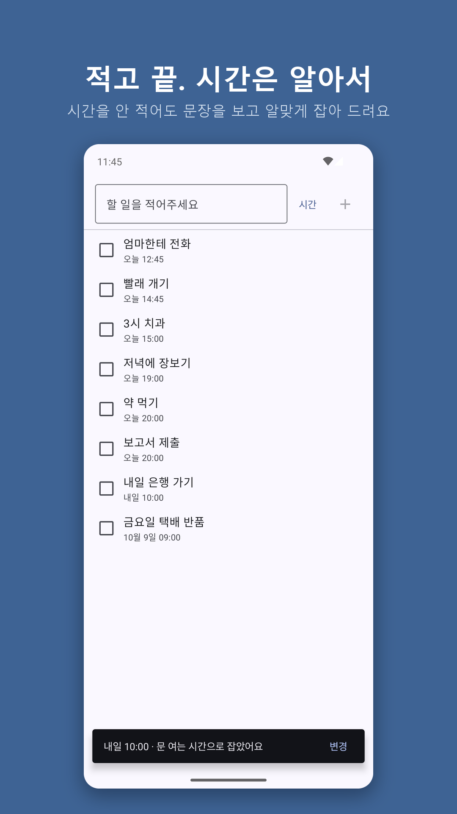
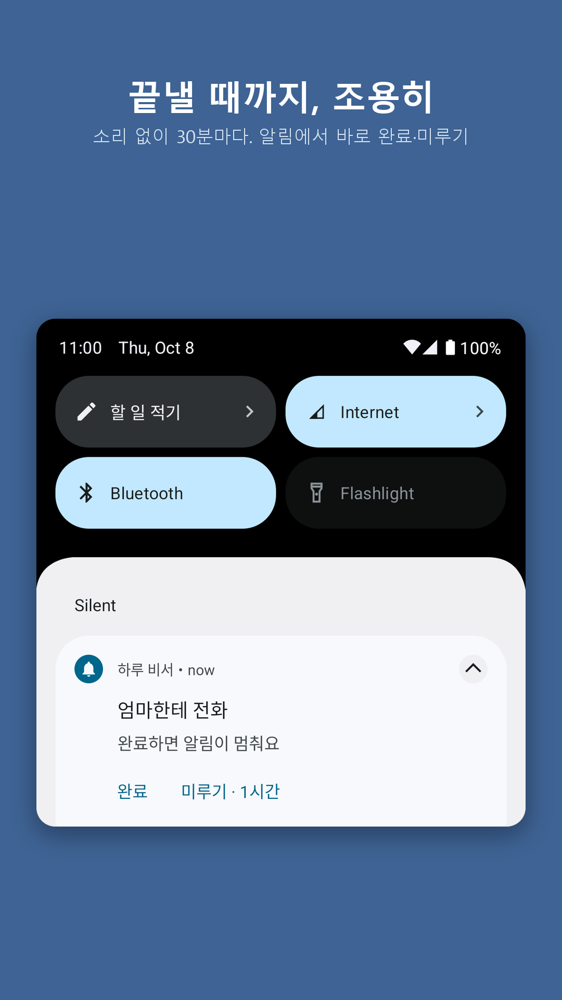
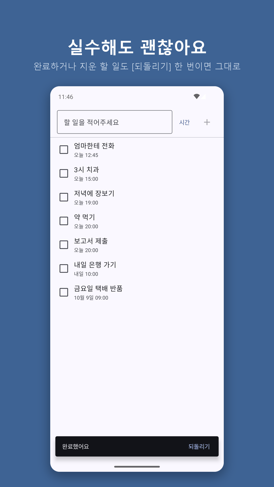

  

## 개요

할 일을 빠르게 적어 두면, 끝낼 때까지 소리 없이 조용히 알려 주는 Android 앱입니다.
"사용자가 신경 쓸 일을 0으로" 만드는 것이 핵심 원칙이라, 알림은 항상 조용하고 점점 시끄러워지지 않습니다.
Android 개발을 익히며 기획부터 스토어 등록 준비까지 직접 진행했습니다.

## 주요 기능

- **빠른 입력** — 앱을 열면 바로 입력창. 적고 [+]만 누르면 저장되고, 시간 선택은 선택 사항입니다.
- **시간 추론** — 시간을 안 적으면 문장을 보고 시간을 잡고, 왜 그 시간인지 보여 줍니다.
  - "내일 은행" → 내일 오전 10시 (내일이 주말이면 월요일)
  - "약 먹기" → 저녁 8시 (밤에 적으면 다음 날 아침 8시)
  - "3시 전화" → 가장 가까운 오후 3시
- **조용한 알림** — 소리·진동 없이, 완료할 때까지 30분마다 다시 표시합니다.
- **완료 / 미루기** — 알림에서 바로 처리. 미룰수록 간격이 늘어납니다 (1시간 → 2시간 → 4시간 … 최대 24시간).
- **되돌리기** — 완료하거나 지운 할 일을 그대로 되살릴 수 있습니다.
- **어디서든 입력** — 다른 앱의 [공유], 상단바 "할 일 적기" 타일로 바로 적습니다.

## 기술 구성

- **화면**: Kotlin + Jetpack Compose (Material3), MVVM 구조
- **저장**: Room (기기 안 SQLite)
- **알림 예약**: AlarmManager 정확한 알람. 재부팅·앱 업데이트 후에도 알림을 복원합니다.
- **시간 추론**: Android에 의존하지 않는 순수 Kotlin 규칙 엔진으로 분리했습니다.

## 개인정보

회원가입·로그인이 없고, 인터넷 권한 자체가 없어 적은 내용은 기기 안에만 저장됩니다.
자세한 내용은 [하루 비서 개인정보처리방침](/haru/privacy.html)에 있습니다.
