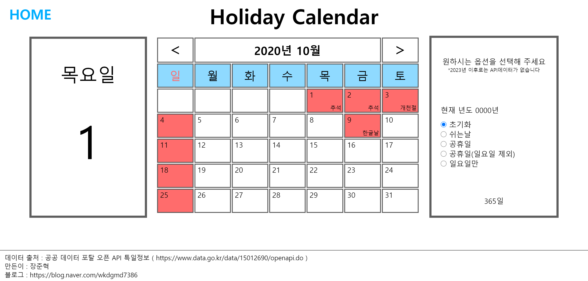
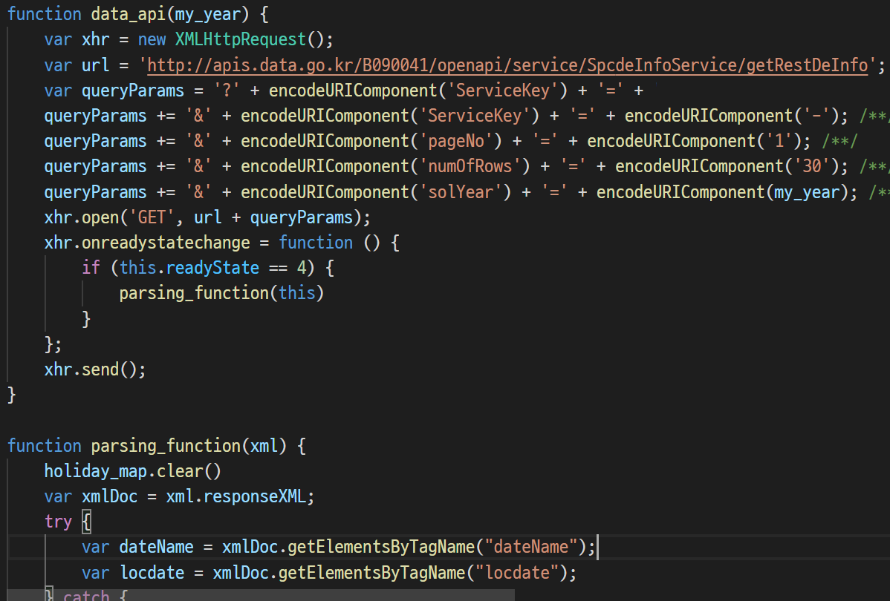
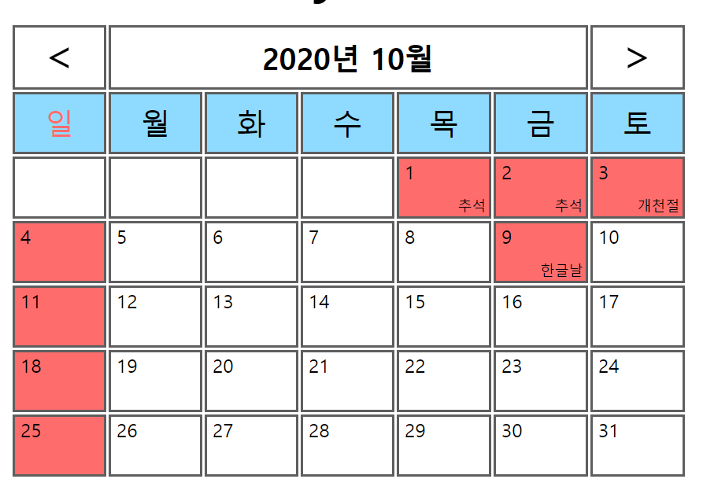
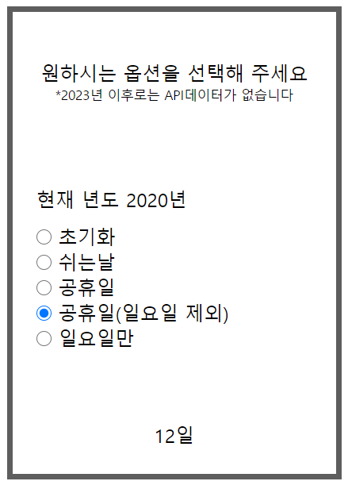

## 개요

- **수행 기간**: 2020.09.22 ~ 2020.09.29 (총 8일)
- **개발 목표**: 매년 공휴일을 알아봄과 동시에, API의 활용 능력을 키우기 위함
- **개발 환경**: 공공데이터포털 오픈 API, VS Code, Windows 10, XML, GitHub Pages, HTML, CSS, SASS, JavaScript, jQuery

## 구현 기능

- `Date()` 값으로 자동 계산하는 달력
- 공공 API를 활용한 데이터 파싱
- 받아온 데이터를 JavaScript를 사용하여 계산
- SASS(SCSS)를 활용하여 화면 가독성 증가

## 화면 설명

### 공휴일 데이터 받아오기 — 공공데이터 오픈 API · XML 파싱

공공 데이터 포털 오픈 API를 사용하여 대한민국에서 정한 공휴일 정보를 받아옵니다.
받아온 XML 데이터를 파싱하여 화면에 뿌려줍니다.

### 달력 그리기 — JavaScript · jQuery · `new Date()`

`new Date()`를 사용하여 원하는 시간을 계산하여 화면에 달력 형식으로 출력하게 하였습니다.
데이터포털 서버에서 XML 데이터로 전달해 준 공휴일들을 파싱하여 배열에 저장한 후, JavaScript와 jQuery를 사용하여 화면에 출력한 달력의 데이터와 비교하여 공휴일에 붉은 배경을 주었습니다.

### 쉬는 날 계산 — 공공데이터 API · jQuery

공공데이터로 받아온 공휴일들의 개수와 일요일의 겹침 여부를 계산하여 화면에 출력해 줍니다.
그해의 일요일만 계산할 수도 있고, 일요일을 제외한 날에 있는 공휴일들을 계산할 수도 있습니다.

## 참여 소감

공공데이터 API를 받아오는 것을 중점으로 프로젝트를 진행하였습니다.
서버에서 받은 XML을 파싱하는 과정에서 Cross-Origin Resource Sharing(CORS) 정책에 관한 것을 알게 되었습니다.
CORS에 의해 다른 출처의 리소스는 브라우저가 파기하기 때문에 직접 서버를 만들어 서버에서 받았어야 했습니다.
그러나 이것은 개인 서버가 아니라 GitHub 서버이기 때문에 브라우저에 예외 조항을 두고 실행하는 방법을 사용하였습니다.
