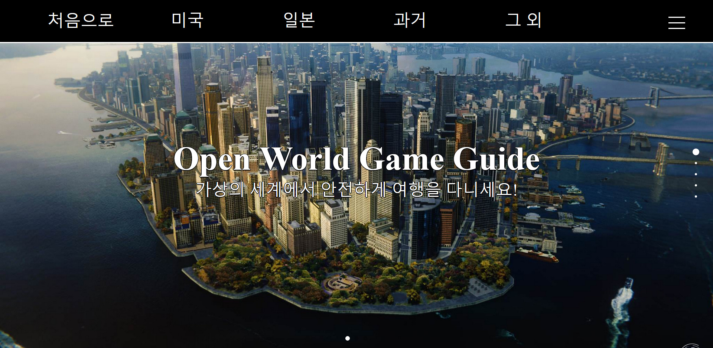
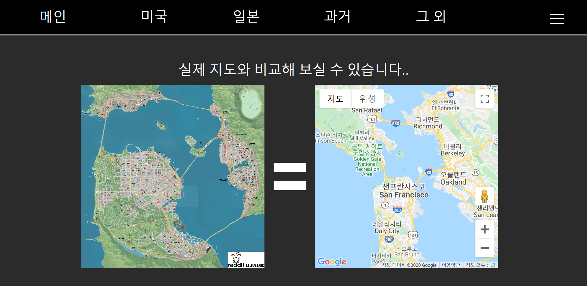
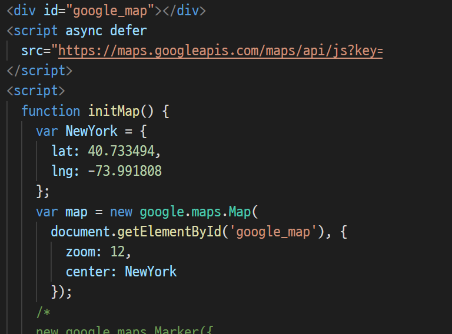
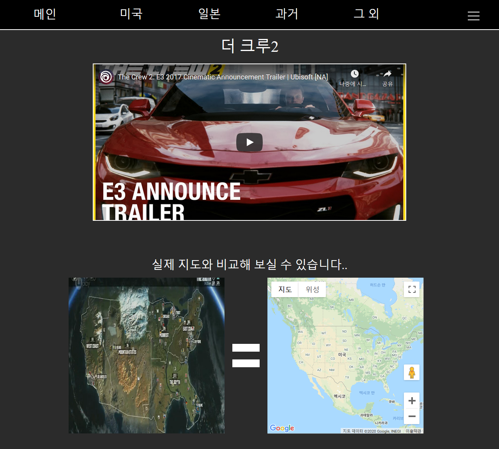

## 개요

- **수행 기간**: 2020.09.16 ~ 2020.09.21 (총 5일)
- **개발 목표**: 오픈월드 게임들의 정보를 비교하고 정리하여 보여주기 위함
- **개발 환경**: Google Cloud Platform (Map API), VS Code, Windows 10, GitHub Pages, HTML, CSS, SASS, JavaScript, jQuery

## 구현 기능

- 구글 클라우드 플랫폼 (Map API) 활용
- 유튜브 동영상 재생
- JavaScript를 사용한 화면 애니메이션

## 화면 설명

### 지도 표시 — Google Maps API

구글 클라우드 플랫폼의 기능 중 하나인 Map API를 사용하여 화면에 지도가 표시되도록 작성했습니다.

### 위치 값 설정 — Google Maps API

각각의 위치 값을 경도·위도와 처음 화면에 보일 때 얼마나 확대되어 있는지 등을 변수에 넣으면, 구글 API가 이 변수를 확인하여 페이지가 실행될 때 알맞은 값으로 불러옵니다.
이 밖에 위치에 핀 꽂기, 지명 나타내기 등이 가능합니다.
또한 구글 클라우드 플랫폼에서 사용 시간 및 요청 트래픽 등을 확인할 수 있습니다.

### 유튜브 영상 · 메뉴

유튜브 공유 기능을 사용하여 화면에 동영상을 삽입하였고, CSS를 사용하여 화면에 맞게 배치하였습니다.
jQuery를 사용하여 메뉴 화면에 마우스가 접근하면 메뉴가 보이도록 하였습니다.

## 참여 소감

포트폴리오 프로젝트를 시작하기 전에 만든 홈페이지입니다. 오픈월드 게임에서 돌아다니며 구경하는 것을 좋아하여 시작했습니다.
게임의 몰입감과 구현도를 알려주기 위하여 구글 맵 API를 사용하였습니다.
카카오 API를 사용하려다가 전 세계 지도가 나오지 않는 것을 확인하였고, 대안으로 구글 API를 선택하였습니다.
비교가 목적이기에 지도에 별다른 정보가 표시되어 있지 않지만, JS로 옵션을 주어 더욱 밀도 높은 지도를 만들 수 있습니다.
